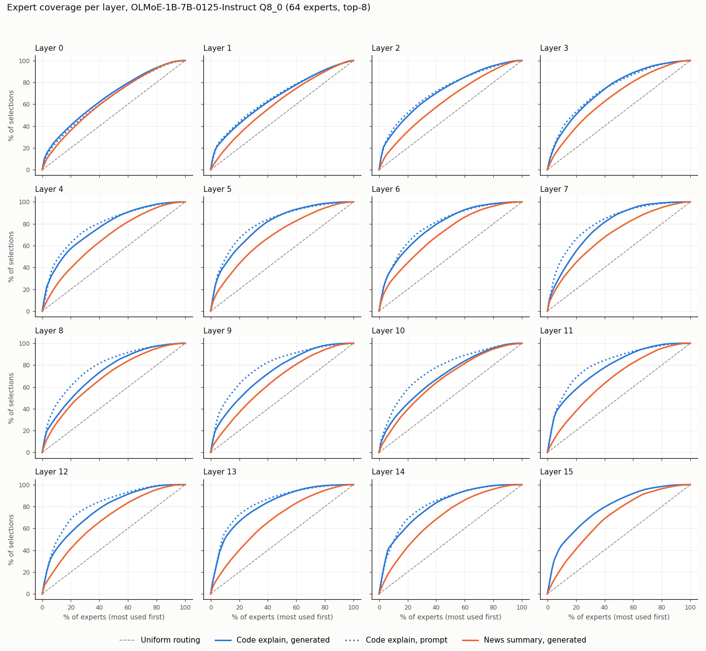

# Week 1: kill test results

**Decision: NO-GO for static expert pinning on OLMoE-1B-7B.** The hot set is very stable
and very task-specific, but routing is not skewed enough: covering 80% of selections takes
about 45% of the experts, not 20–30%. In the simulation, a policy modeled on llama.cpp's existing
adaptive expert cache matches or beats a profiled static hot set at every budget tested.

Every number below comes from `./reproduce.sh` (outputs: `results/coverage_summary.json`,
`results/cache_sim.json`, `results/coverage_by_layer.csv`).

## Setup

- **Machine:** the owner's iMac, i5-6500, 16 GB RAM, CPU only (`results/hardware.md`).
- **Model:** OLMoE-1B-7B-0125-Instruct, Q8_0 GGUF, llama.cpp `d2b3eb9b`. 16 MoE layers,
  64 experts per layer, top-8 routing (read from the GGUF metadata). So each token makes
  16 × 8 = 128 expert selections.
- **Data** (`data/README.md`):
  - Task A, explain Python code: 80 CPython stdlib chunks.
  - Task B, summarize news: 80 Wikinews articles.
- **Capture** (`capture/route_trace.cpp`): reads the `ffn_moe_topk-<layer>` node through
  llama.cpp's `cb_eval` callback. It runs the prompt as one batch, then greedy decodes up to
  200 tokens.
  - Captured: 90,741 prompt tokens and 28,670 generated tokens. Task A generated all
    16,000 tokens; task B generated 12,670, because 63 of its 80 summaries ended before
    200 tokens.
  - Sanity checks passed: every token has 8 distinct experts in every layer, and the counts
    sum correctly.
- **Held-out split:** task A half A = inputs 0–39, half B = inputs 40–79, 8,000 generated
  tokens each.

## Results (generated tokens unless stated)

### 1. Skew: what share of experts covers X% of selections (median layer, [min–max])

| | 50% | 80% | 95% |
|---|---|---|---|
| Uniform routing | 50% | 80% | 95% |
| **Task A, generated** | **17.2%** [10.9–29.7] | **44.5%** [35.9–64.1] | 70.3% [62.5–87.5] |
| Task A, prompt (layers 0–14) | 12.5% [9.4–31.2] | 39.1% [29.7–64.1] | 70.3% [62.5–89.1] |
| Task B, generated | 28.1% [25.0–35.9] | 57.0% [53.1–67.2] | 81.2% [78.1–89.1] |

- Routing is clearly skewed compared with uniform. But no layer reaches 80% coverage with
  30% of its experts: the best is layer 13 at 35.9%.
- The first two layers (0, 1) are nearly flat and need about 61–64% of experts for 80%.
- Task B (news) is much flatter than task A (code).

### 2. Stability: hot set from half A, measured on half B (task A)

| Budget (experts/layer) | Covers half A | **Covers half B** | Best possible on B | Uniform | Hot-set overlap A vs B (Jaccard) |
|---|---|---|---|---|---|
| 10% (6) | 36.9% | 36.7% | 36.7% | 9.4% | 0.93 |
| 20% (13) | 54.1% | **53.6%** | 53.6% | 20.3% | 0.89 |
| 30% (19) | 65.3% | **64.7%** | 64.8% | 29.7% | 0.91 |
| 50% (32) | 83.3% | 82.6% | 82.7% | 50.0% | 0.94 |

The hot set is extremely stable: built on 40 inputs, it is within 0.1 points of the best
possible set on 40 other inputs. This part of the hypothesis holds.

### 3. Task specificity: task A's hot set used on task B

| Budget | A's set on A | **A's set on B** | B's own set on B | Overlap (Jaccard) |
|---|---|---|---|---|
| 20% | 53.8% | **19.3%** | 40.2% | 0.13 |
| 30% | 65.0% | **29.7%** | 52.4% | 0.23 |
| 50% | 83.0% | 49.6% | 73.6% | 0.38 |

The code hot set is no better than random on news: 29.7% coverage at a 30% budget, the same
as uniform. A profile is strictly per task, so a wrong profile would be worthless.

### 4. Misses per generated token (hot set from half A, measured on half B)

A token has 128 selections. "Cold" means the selected expert is outside the hot set.

| Budget | Cold experts per token (mean) | Tokens with zero cold experts | Layer visits with all 8 experts hot |
|---|---|---|---|
| 10% | 81.1 | 0% | 0% |
| 20% | 59.4 | 0% | 1.2% |
| 30% | 45.2 | 0% | 5.5% |
| 50% | 22.2 | 0% | 29.5% |

Even with half of all experts pinned, every generated token still needs about 22 cold
experts. No token in 8,000 was fully served from the hot set at any budget.

### 5. Page-cache baseline (SIMULATION, `analysis/cache_sim.py`)

Mean cold experts per generated token on half B, at the same per-layer budget:
- **Static hot set:** profiled on half A.
- **LRU:** keeps the most recently used experts, as a stand-in for the OS page cache. It is
  fed prompt and generated tokens in order and starts warm with half A.
- **CRF:** a simplified version of the policy in llama.cpp's own `--moe-cache-mib` GPU
  expert cache (recency plus frequency, 128-token half-life). "Gen only" means prompt tokens
  don't touch the cache.

| Budget | Static hot set | LRU | CRF | CRF, gen only |
|---|---|---|---|---|
| 10% | 81.1 | 112.7 | **77.6** | 77.8 |
| 20% | 59.4 | 61.5 | 53.5 | **51.9** |
| 30% | 45.2 | 46.6 | 42.0 | **38.9** |
| 50% | 22.2 | 24.0 | 22.4 | **19.0** |

- **Static vs LRU (RAM tier):** at the 20–50% budgets that matter, the static set saves only
  3–7% of misses compared with LRU. A starting-empty LRU and a warm LRU give the same numbers,
  because one prompt fills the cache. As CLAUDE.md asks us to say plainly: **LRU nearly
  matches the static hot set, so the RAM tier adds little beyond warm-up.**
- **Static vs llama.cpp's policy (VRAM tier):** the adaptive CRF policy beats the static set
  by 4–14% at 10–30% budgets. At 50% it ties when prompt tokens also touch the cache
  (22.4 vs 22.2) and wins when only generated tokens do (19.0). llama.cpp already ships
  this policy.

## GO / NO-GO

Checked against the decision rule:

| Criterion | Result |
|---|---|
| 20–30% of experts cover 80%+ of held-out generated selections | **No.** 20% covers 53.6%, 30% covers 64.7%; 80% needs about 45% (median layer). |
| Hot set from half A holds on half B | **Yes**, almost perfectly (64.7% vs best possible 64.8%; Jaccard 0.9). |
| A pinning option is feasible without writing an engine | **Yes** (`results/pinning_options.md`: a RAM-locking helper, or seeding llama.cpp's MoE cache). |
| Static set beats what the page cache / existing cache does | **Barely vs LRU (3–7%); no vs llama.cpp's MoE cache policy (CRF ties or wins at every budget).** |

**NO-GO** for static pinning on this model and task:
1. **The skew is too weak.** Because a token needs all 128 of its selections, even a 50%
   budget leaves about 22 cold experts per token and zero fully-hot tokens. Each token still
   waits on slow storage, so a static set cannot turn an SSD-bound model into a RAM-speed one.
2. **The existing baseline already does as well or better.** The RAM tier gains 3–7% over LRU.
   The VRAM tier already has an adaptive per-expert cache in llama.cpp that matches or beats
   a static profile.

What did hold, and is worth keeping:
- **Routing is very stable within a task.**
- **Routing is very different between tasks.**

A future tool could use a profile to warm-start an adaptive cache or to choose which experts to
prefetch. It should not use the profile as a fixed pin list.

## Limits of this test

- **One model, one quantization.** OLMoE-1B-7B, Q8_0. Models with more, finer-grained experts
  (e.g. Qwen3-30B-A3B: 128 experts, top-8) may be more skewed. **Not tested.**
- **Two tasks only.** Task A is a single programming language from a single codebase, which
  probably makes it more skewed than real-world code. Task B summaries are short, so 63 of 80
  stopped before 200 tokens.
- **Greedy decoding and 200-token outputs.** Longer generations or sampling may route
  differently.
- **The cache comparison is a simulation**, not a measurement:
  - Unit is one whole expert, with a separate budget per layer.
  - Strict LRU stands in for the macOS page cache. The real cache works on 16 KB pages, is
    shared across layers and other apps, and is not strict LRU.
  - CRF keeps llama.cpp's scoring idea but not its class lists or shared slots.
- **No tokens-per-second number is claimed.** The capture ran with a per-layer callback under
  memory pressure (generation was 2–9 tok/s), so its speed means nothing.
- **Prompt last layer.** llama.cpp runs the last MoE layer only for the final prompt token,
  because no other prompt token needs it. Prompt statistics therefore use layers 0–14.

## Options from here (owner's call; CLAUDE.md says try another task or model, or stop)

1. **Stop static pinning.**
2. **Test whether a profile helps an adaptive cache.** Seed or prefetch for llama.cpp's MoE
   cache: about one evening, a simulation-only change to `analysis/cache_sim.py` on the
   existing trace.
3. **Re-run the kill test on a fine-grained MoE** (e.g. Qwen3-30B-A3B). That needs a machine
   with more RAM, or a cloud box for the profile; routing doesn't depend on hardware.
